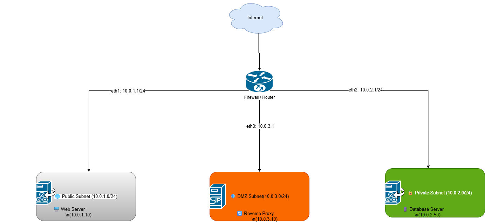

# 🌐 Automated Dual-Subnet & Secure Gateway Laboratory

An enterprise-ready, automated infrastructure environment deployed natively within Linux. This lab provisions fully isolated networking zones utilizing software bridges, configures stateful kernel firewalls via `iptables`, and provides built-in automated test suites using `netcat` to mathematically validate security boundary policies.

---

## 🗺️ Architectural Topology

Below is the design layout detailing the segment partitions, interface identities, and target nodes:



### Network Segment Matrix

| Zone Name | Network Address Space | Assigned Subnet Gateway | Configured Network Nodes |
| :--- | :--- | :--- | :--- |
| **🌐 Public Subnet** | `10.0.1.0/24` | `10.0.1.1` (`eth1`) | Web Server (`10.0.1.10`) |
| **🔒 Private Subnet** | `10.0.2.0/24` | `10.0.2.1` (`eth2`) | Database Server (`10.0.2.50`) |

---

## ⚙️ Core Infrastructure Automation

The complete dual-subnet environment is managed dynamically via a single shell utility. 

### Provisioning Framework
The script **`configs/setup-network.sh`** provisions the infrastructure:
1. **Virtual Switches:** Allocates software bridge points (`public-br` and `private-br`).
2. **Interface Identities:** Binds the explicit CIDR-compliant gateway values.
3. **Boundary Firewall:** Enforces an asynchronous traffic dynamic—allowing stateful output initialization while explicitly dropping unauthorized crossover attempts from public to private spaces.

```bash
sudo ./configs/setup-network.sh
```

---

## 🧪 Automated Testing & Verification

To confirm structural security and prevent manual oversight, the test engine **`tests/verify-isolation.sh`** evaluates routing constraints and records validation logs directly into the engineering files.

```bash
sudo ./tests/verify-isolation.sh
```

### Verified System Report Output
```text
🔍 Starting automated network isolation tests...
--------------------------------------------------
📡 Test 1: Checking if Public Gateway (10.0.1.1) is online...
🟢 SUCCESS: Public subnet gateway is reachable.

🛡️ Test 2: Simulating unauthorized crossover connection request...
👉 Attempting to connect from public switch interface to private network...
🔒 FIREWALL SECURE: Connection blocked cleanly by kernel isolation policy.
🟢 TEST PASSED: Network isolation is operating exactly as designed!
--------------------------------------------------
✅ Verification complete.
```
